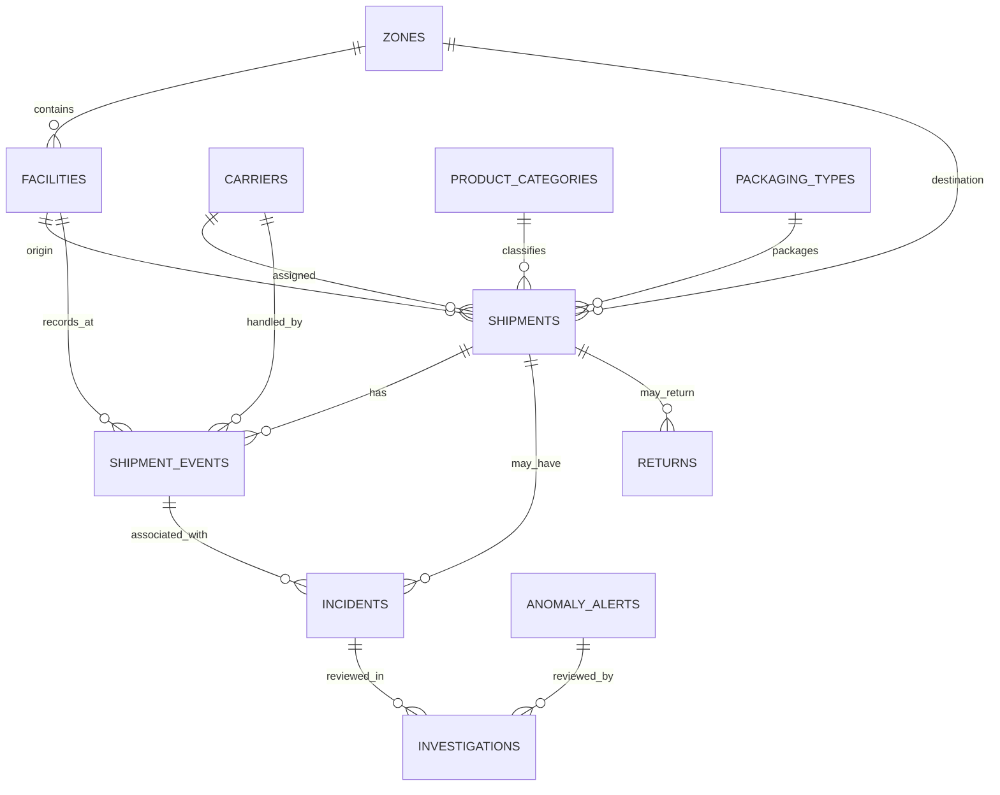

# 05 — Relational Model & Integrity Rules

## Entity relationships

## Design choices

1. `shipments` is one row per shipment. It is not a package-item table.
2. `shipment_events` is append-oriented and stores the event timeline. Do not overwrite previous events when status changes.
3. `incidents` records reviewed operational incidents separately from event anomalies.
4. `anomaly_alerts` stores model/rule outputs. It does not store confirmed truth.
5. `investigations` stores human review and outcome.
6. `returns` is a separate reverse-logistics process linked to the original shipment.
7. Synthetic scenario truth is isolated from operational data and features.

## Data integrity and temporal rules

- Shipment event `sequence_number` is unique within a shipment.
- Sort events by `occurred_at`, then `sequence_number`, while flagging contradictory timestamp ordering as a data-quality issue.
- `recorded_at` may be later than `occurred_at`.
- Incident `reported_at` may occur after the physical event; do not assume event time equals report time.
- A shipment may have an incident with no confidently associated event.
- A shipment may be returned for reasons unrelated to damage.
- A confirmed damage incident must be explicitly represented in `incidents`.
- Never infer damage solely from an event such as `inspection_required` or from an anomaly score.
- Facility and carrier attribution should be nullable when not known. Do not fill unknown values with a fabricated responsible entity.

## Recommended implementation order

1. Create reference dimensions.
2. Create shipments.
3. Create shipment events.
4. Create incidents and returns.
5. Create alerts and investigations.
6. Add evaluation-only scenario truth in an isolated schema.
7. Build analytical views only after base-table tests pass.
